# Registry Integrity Report (v1)

**Audited Workspace:** `D:\Kalyani Tech\Kalyani Records\Company Presentation & Brochure\Kalyani Website\Website Content n Working`  
**Subsystem:** `Website_Codebase`  
**Audit Date:** 31 October 2026  
**Auditor:** Antigravity Universal Harness Engine  
**Status:** Read-Only Integrity Audit Completed (Stage 1)

---

## 1. Executive Summary

This report establishes the baseline integrity of all technical, product, corporate, governance, and static document registries across the Kalyani Cast Tech Limited workspace. It verifies the boundaries between **Authoritative Company Source Records** (`01_Rewari`, `02_Products_Containers`, `04_Company_Team`, `05_Documents`, `07_Certificates`) and **Website Production Assets** (`Website_Codebase/public/` and `Website_Codebase/src/content/`).

```mermaid
flowchart LR
    subgraph S["Authoritative Company Records"]
        A1["05_Documents (24 PDFs)"]
        A2["07_Certificates (9 Files)"]
        A3["02_Products_Containers (29 Files)"]
        A4["01_Rewari & 04_Company_Team"]
    end

    subgraph R["Content Registries (Codebase)"]
        B1["route-assets.ts (ROUTE_DOCUMENTS)"]
        B2["pages.json (Content Architecture)"]
        B3["ContainerCatalog.tsx (17 Models)"]
        B4["WagonCatalog.tsx (5 Models)"]
    end

    subgraph P["Public Web Assets"]
        C1["/documents/investors/..."]
        C2["/documents/certificates/..."]
        C3["/assets/containers/..."]
        C4["/assets/wagons/..."]
    end

    S -.->|Read-Only Ingestion| R
    R -->|Verified Mapping| P
```

---

## 2. Product Catalogue Registry Audit

### A. Container Models Structure
- **Registry File:** [`Website_Codebase/src/components/site/ContainerCatalog.tsx`](file:///d:/Kalyani%20Tech/Kalyani%20Records/Company%20Presentation%20&%20Brochure/Kalyani%20Website/Website%20Content%20n%20Working/Website_Codebase/src/components/site/ContainerCatalog.tsx)
- **Image Registry:** [`Website_Codebase/src/content/route-assets.ts`](file:///d:/Kalyani%20Tech/Kalyani%20Records/Company%20Presentation%20&%20Brochure/Kalyani%20Website/Website%20Content%20n%20Working/Website_Codebase/src/content/route-assets.ts) (`CONTAINER_MODEL_ASSETS`)
- **Total Registered Models:** 17 distinct engineering configurations across 5 categories:
  - Standard ISO (Models 1, 2, 3, 4)
  - Dwarf Range (Models 5, 11)
  - Coiltainers & Heavy Cargo (Models 6, 7, 8, 9, 10, 12, 13)
  - Tank, Hopper & Special (Models 14, 15, 17)
  - CUBOID Parcel & Automotive Boxes (Model 16)
- **Integrity Checks:**
  - 17/17 models have complete physical dimensions, gross weight, tare weight, payload, and cubic capacity.
  - Floor strength certified parameter strictly preserved at **7,260 kg** test load where applicable.
  - Heavy coiltainer handling rating strictly preserved at **Lift-On 36 MT / Chassis 71 MT**.
  - Model 04 dual volumetric configuration preserved: **84.00 m³ cotton bale configuration** vs. **76.09 m³ ISO configuration**.
  - Model 06 dimensions preserved: **12,192 × 2,438 × 2,591 mm and 61.03 m³**.
  - Model 17 (304-Grade Stainless Steel Salt Container) explicitly flagged with **Prototype Under Review** badge to maintain strict truth in advertising while formal commercial memo is pending.

### B. Railway Rolling Stock & Wagons Registry
- **Registry File:** [`Website_Codebase/src/components/site/WagonCatalog.tsx`](file:///d:/Kalyani%20Tech/Kalyani%20Records/Company%20Presentation%20&%20Brochure/Kalyani%20Website/Website%20Content%20n%20Working/Website_Codebase/src/components/site/WagonCatalog.tsx)
- **Image Registry:** `WAGON_ASSETS` in `route-assets.ts`
- **Total Registered Models:** 5 rolling stock models (W1: BCACBM Bi-Level Car Carrier, W2: BCFCM Bulk Cement Hopper, W3: BLCS 25T Axle Load Flat, W4: BFNS Heavy Steel Coil Wagon, W5: RORO Multimodal Wagon).
- **Integrity Checks:**
  - All 5 models are clearly marked **"Under Development"** with the operational caveat: *"Commissioning target Q4 FY 2026–27 at Shivlakha Works under execution by wholly owned subsidiary KMT Engineering Pvt. Ltd."*
  - Ministry of Railways / RDSO Stage-I Concept Approval (granted 26 October 2026) is cited with exact date and authority.

---

## 3. Investor & Governance Documents Registry Audit

### A. Source Collection (`05_Documents`)
The master corporate documents folder contains 24 unique PDF records:
1. `Annual Statements`: 7 statements spanning FY 2023–24, FY 2024–25, and H1 FY 2025–26.
2. `Code of Conduct`: 11 statutory policies adopted by the Board of Directors (Policies A through K).
3. `DRHP Prospectus`: 5 offer and regulatory documents (DRHP, RHP, Final Prospectus, Determination of Material Events, Insider Trading Policy).
4. `Root`: Revised Articles of Association (`Revised-AOA.pdf`).

### B. Public Delivery Registry (`ROUTE_DOCUMENTS`)
- **Location:** `Website_Codebase/src/content/route-assets.ts`
- **Integrity Status:**
  - `/investors/corporate-governance`: 12 verified documents registered with title, file size, scope, and download action. All 12 files verified present on disk.
  - `/investors/financial-information`: 4 audited statements registered and verified.
  - `/investors/ipo-corporate-actions`: 6 offer and regulatory compliance documents registered and verified.
  - `/investors/meetings-presentations`: Institutional investor presentation registered and verified.
- **Privacy Gate Compliance (§13):**
  - `Shareholding-pattern_31.03.2026.pdf` withheld from public download due to unredacted promoter PAN numbers on Page 8 Table II.
  - Typo duplicate files (`Statment-of-Deviation_31.09.2024.pdf`, `...-1.pdf`) purged from public folder and 301 redirects mapped in `_redirects`.

---

## 4. Certificates & Approvals Registry Audit

### A. Source Collection (`07_Certificates`)
Contains 9 source files representing authentic legal accreditations:
1. **IRS Capacity Certificate:** Report No. DLH21X014 (dated 24 June 2021) certifying manufacturing capacity &ge;1,000 ISO Series-1 containers per year.
2. **IRS Competent Manufacturer:** CSC 1972 container manufacturer approval.
3. **Lloyd's Register EMEA Approval:** Certificate LR2489004WA issued 20 June 2024, valid until **30 June 2027** for steel castings up to 18 kg.
4. **Superseded Lloyd's Register Approval:** Certificate LR21254575WA expired 30 June 2024 (correctly segregated to historical archive).
5. **ISO 9001:2015:** Certificate QACS-UAF-Q-KC-08.24.1343, valid until **10 October 2027**.
6. **ISO 14001:2015:** Certificate PCPL-EMS-KC-6040, valid until **22 August 2028**.
7. **ISO 45001:2018:** Certificate QACS-UAF-OH-KC-08.24.888, valid until **10 October 2027**.
8. **RDSO Class 'A' Foundry Approval:** Vendor Code 450 under IS 12117:1996.
9. **Railway Board Dwarf Registration:** Design Registration No 206997.

### B. Privacy & Legal Integrity:
- Employee personal training records (Pages 4–6 of `QACS CERTIFICATE.pdf`) withheld from public publication.

---

## 5. Broken References & Dead Links Verification

An automated crawl across all code files and routes confirmed:
- **Total Unique Asset References:** 121
- **Assets Found on Disk:** 121
- **Missing / Broken Assets:** **0 (Zero)**
- **Console Errors in Production Build:** **0 (Zero)**

---

## 6. Registry Improvement Recommendations

1. **Centralize Product Master Record:** The 17 models are currently defined in `ContainerCatalog.tsx`. In future phases, extract `CONTAINER_MODELS` into a standalone typed TypeScript data file `src/content/products.ts` for clean single-source editing.
2. **Standardize Public Document Paths:** Maintain strict adherence to lowercase hyphenated paths under `public/documents/` to avoid case-sensitivity issues on Netlify CDN.

