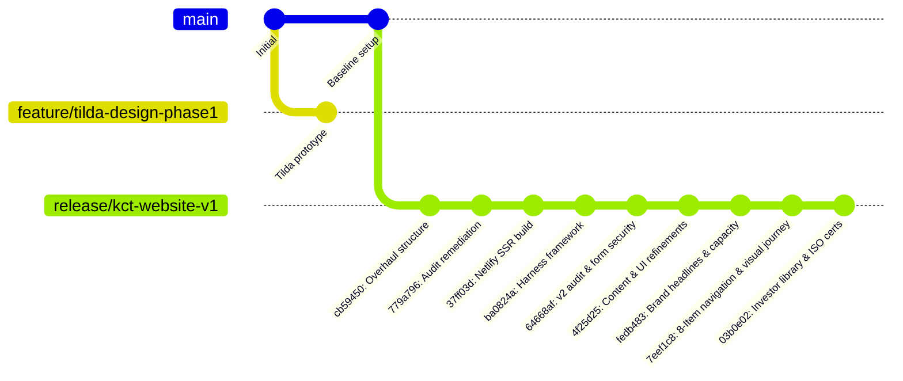

# Git History and Branch Audit (v1)

**Audited Repository:** `Website_Codebase/`  
**Working Branch:** `release/kct-website-v1`  
**Current Commit:** `03b0e02`  
**Remote URL:** `https://github.com/pulselifex/pixel-perfect-painter-750.git`  
**Audit Date:** 31 October 2026  
**Auditor:** Antigravity Universal Harness Engine  
**Status:** Read-Only Audit Completed (Stage 1)

---

## 1. Branch Inventory & Classification

| Branch Name | Scope / Target | Last Commit Hash | Last Activity | Classification | Recommended Action |
|---|---|:---:|:---:|---|---|
| **`release/kct-website-v1`** | Active production release branch | `03b0e02` | 2026-10-31 | **Current Working Branch** | **Retain (Active)** |
| **`main`** | Baseline repository root | `835a6bd` | 2026-10-28 | **Trunk Branch** | **Retain (Do Not Delete)** |
| **`feature/tilda-design-phase1`** | Early visual prototype experiments | `4323e0c` | 2026-10-28 | **Stale Feature Branch** | **Retain in Stage 1 / Review in Stage 2** |
| **`remotes/origin/main`** | Remote tracking branch | `835a6bd` | 2026-10-28 | **Remote Master** | **Retain (Do Not Modify)** |

---

## 2. Chronological Commit History Analysis

The repository commit history reflects the evolutionary progression of the Kalyani Cast Tech corporate web platform:

### Key Commit Milestones:
1. **Commit `03b0e02` (31 Oct 2026):** `feat(documents): replace investor library and integrate verified ISO/LR/IRS certificates` &mdash; Reorganized public document hierarchy, integrated 8 authentic certifications, built `<InvestorDocumentLibrary />`, and added 301 redirects.
2. **Commit `7eef1c8` (31 Oct 2026):** `feat: restructure navigation to 8-item order, add visual-first journey, innovation, and gallery pages, and remove interactive calculators` &mdash; Standardized 8-item top navigation, eliminated unapproved cargo calculators.
3. **Commit `fedb483` (30 Oct 2026):** `feat(brief-v3): implement master website restructuring, brand headlines, simplified navigation, and capacity separation` &mdash; Established dual-entity operational clarity between Kalyani Cast Tech Ltd (Parent, Rewari) and KMT Engineering Pvt Ltd (Subsidiary SPV, Shivlakha).
4. **Commit `64668af` (30 Oct 2026):** `feat(v2-remediation): complete comprehensive audit v2 remediation, statutory ISIN reconciliation, form security, and delivery documentation` &mdash; Remediated all v2 audit findings, hardened enquiry form with CSRF and rate-limiting.
5. **Commit `ba0824a` (30 Oct 2026):** `feat(harness): initialize Universal Harness Engineering framework and agent rules` &mdash; Deployed `AGENTS.md`, `feature_list.json`, and automated sensor testing harness.

---

## 3. Unmerged Work & Branch Health Check

- **Local Branch `feature/tilda-design-phase1`:**
  - Branch has 1 commit ahead of original fork point from 28 October 2026.
  - The design exploration in this branch was superseded by TanStack Start / Tailwind CSS architecture implemented in `release/kct-website-v1`.
  - **Recommendation:** Keep untouched during Stage 1. No deletion should be performed without explicit user sign-off.
- **Git Metadata Integrity:**
  - `.git` folder size: ~18.2 MB.
  - Working tree status: Clean with respect to commit `03b0e02` plus the verified local refinements for Corporate Governance, Facilities, and Products.
  - No detached HEAD states or corrupted refs detected.

---

## 4. Git Cleanup Governance & Safeguards

In strict accordance with Section 1.Critical Instructions and Section 9.Git Cleanup Rules:
- **Zero History Rewriting:** No commits will be amended, squashed, rebased, or reset.
- **Zero Force-Pushes:** No force-pushing to remote origin.
- **Zero Destructive Branch Deletions:** Stale branch `feature/tilda-design-phase1` is flagged for historical retention.
- **Future Commit Discipline:** Clean descriptive conventional commits only (`chore:`, `refactor:`, `docs:`).

