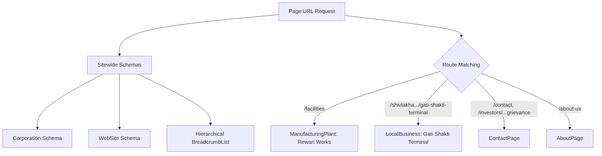

# WP-5B.25A — Structured Data Semantic Audit & Schema.org Validation

**Programme:** Kalyani Cast Tech Limited Corporate Website Modernisation  
**Work Package:** WP-5B.25A — Search Indexability, Canonical Strategy, Metadata & Structured Data Correction  
**Entity Grounding:** Kalyani Cast Tech Limited (CIN: `L26990DL2012PLC242760`, BSE SME: `544023`)  
**Specification:** Schema.org JSON-LD / Google Search Central Guidelines  
**Date:** 6 November 2026  
**Status:** `SEMANTICALLY AUDITED & VALIDATED`  

---

## 1. Architecture Overview

Under WP-5B.25A, Schema.org JSON-LD generation in `src/content/seo-metadata.ts` was audited semantically to ensure every structured claim reflects authentic corporate reality without fabricating e-commerce or consumer attributes.

All structured data is generated server-side via `generateStructuredData(path)` and injected directly into the HTML `<head>` as `<script type="application/ld+json">`.

---

## 2. Schema Type-by-Type Semantic Validation

### A. Corporation / Organization Schema (`@type: "Corporation"`)
- **Legal Entity:** `Kalyani Cast Tech Limited` (Alternate: `Kalyani Cast Tech`).
- **Identifiers:** PropertyValue pairs for Corporate Identity Number (`CIN: L26990DL2012PLC242760`) and BSE SME Scrip Code (`544023`).
- **Registered Office:** `B-144, Second Floor, DDA Shed, Phase-1, Okhla Industrial Area Phase-1, New Delhi - 110020, India`.
- **Contact Points:** Distinct telephone and email contacts for Sales (`+91-9650891119`) and Investor Relations (`cs@kalyanicasttech.com`).
- **SameAs Grounding:** Authoritative third-party URLs:
  - BSE India Official Security Profile (`https://www.bseindia.com/stock-share-price/kalyani-cast-tech-ltd/kct/544023/`)
  - Official Corporate Broadcast (`https://www.youtube.com/watch?v=7CTzRhpazSQ`)
- **Semantic Verdict:** **PASS.** Conforms strictly to Google corporate profile guidelines; no unverified social handles or regional branches.

### B. WebSite Schema (`@type: "WebSite"`)
- **Canonical URL:** `https://kalyanicasttech.com/`.
- **Publisher Reference:** Linked directly to Corporation schema via `@id: "https://kalyanicasttech.com/#corporation"`.
- **Language:** `en-IN`.
- **SearchAction Exclusion:** SearchAction was deliberately omitted because the website does not host an external queryable public search endpoint. Faking a Google Site Search action is a Google guidelines violation.
- **Semantic Verdict:** **PASS.**

### C. Hierarchical BreadcrumbList Schema (`@type: "BreadcrumbList"`)
Under WP-5B.25A, breadcrumb navigation was upgraded to support true hierarchical parent-child relationships for all 27 canonical routes:
1. **Manufacturing Hierarchy:**
   - `/facilities`: `Home` > `Manufacturing` > `Manufacturing Facilities`
   - `/products-applications`: `Home` > `Manufacturing` > `Products & Applications`
   - `/innovation`: `Home` > `Manufacturing` > `Innovation`
   - `/engineering-quality`: `Home` > `Manufacturing` > `Engineering & Quality`
2. **Terminal Division Hierarchy:**
   - `/shivlakha-rail-logistics/gati-shakti-terminal`: `Home` > `Shivlakha` > `Gati Shakti Terminal`
   - `/shivlakha-rail-logistics/inland-container-terminal`: `Home` > `Shivlakha` > `Inland Container Terminal`
   - `/shivlakha-rail-logistics/cargo-opportunities`: `Home` > `Shivlakha` > `Rail Route & Cargo Evaluation`
3. **Investor Relations Hierarchy:**
   - `/investors/financial-information`: `Home` > `Investor Relations` > `Financial Information`
   - `/investors/stock-exchange-disclosures`: `Home` > `Investor Relations` > `Stock Exchange Disclosures`
   - `/investors/corporate-governance`: `Home` > `Investor Relations` > `Corporate Governance`
   - `/investors/shareholder-information`: `Home` > `Investor Relations` > `Shareholder Information`
   - `/investors/ipo-corporate-actions`: `Home` > `Investor Relations` > `IPO & Corporate Actions`
   - `/investors/investor-grievance-contact`: `Home` > `Investor Relations` > `Investor Grievance Contact`
   - `/investors/meetings-presentations`: `Home` > `Investor Relations` > `Meetings & Presentations`
4. **Resources Hierarchy:**
   - `/resources/quality-certifications`: `Home` > `Resources` > `Quality Documents & Certificates`
   - `/resources/corporate-profile-brochures`: `Home` > `Resources` > `Corporate Profile & Brochures`
   - `/resources/news-media`: `Home` > `Resources` > `News & Railway Trials`
- **Semantic Verdict:** **PASS.** All URLs link to genuine canonical targets and breadcrumb names match visible UI landmarks.

### D. ManufacturingPlant Schema (`@type: "ManufacturingPlant"`)
- **Route:** `/facilities`
- **Facility Name:** `Rewari Manufacturing Works`
- **Address:** `Village Mamaria Thethar, Tehsil Khol, Rewari, Haryana - 123101, India`.
- **Capability Attributes:** In-house container fabrication sheds, dual induction melting furnaces, and structural load testing rigs.
- **Semantic Verdict:** **PASS.** Strictly represents physical industrial production capacity.

### E. LocalBusiness Schema (`@type: "LocalBusiness"`)
- **Route:** `/shivlakha-rail-logistics/gati-shakti-terminal`
- **Corrected Name:** `Gati Shakti Terminal (Shivlakha)` (purged unapproved "Cargo" from public name).
- **Address:** `Khasra No. 438, Village Shivlakha, Taluka Bhachau, Kachchh, Gujarat - 370145, India`.
- **Operational Reality:** Explicitly notes operational 30-acre broad-gauge rail siding inaugurated on 15 September 2026.
- **Inland Container Terminal Distinction:** LocalBusiness schema is **NOT** applied to the Inland Container Terminal, as it is under development (CBIC approval 10 Sept 2026) and not yet commercially commissioned.
- **Semantic Verdict:** **PASS.**

### F. ContactPage & AboutPage Schemas
- **ContactPage:** Injected on `/contact` and `/investors/investor-grievance-contact` with direct corporate mainEntity link.
- **AboutPage:** Injected on `/about-us` anchoring corporate leadership and founding milestones.
- **Semantic Verdict:** **PASS.**

---

## 3. Strict Proscription on Fabricated B2B Product Schemas

| Potential Schema Type | Status | Regulatory & Technical Rationale |
| :--- | :--- | :--- |
| `Product.offers.price` | **STRICTLY PROHIBITED** | Containers and foundry castings are bespoke industrial capital goods manufactured against engineer drawings. Fixed e-commerce prices do not exist. |
| `AggregateRating` / `Review` | **STRICTLY PROHIBITED** | Fabricating star ratings or consumer reviews on an industrial OEM site violates Google Search Essentials policy and triggers algorithmic/manual penalties. |
| `ItemAvailability` | **STRICTLY PROHIBITED** | Industrial equipment is manufactured per tender or purchase order; off-the-shelf inventory claims are false. |

---

## 4. Schema Issues Identified and Corrected

| No | File | Component | Issue Identified | Correction Executed | Status |
| :--- | :--- | :--- | :--- | :--- | :--- |
| 1 | `seo-metadata.ts` | LocalBusiness Schema | Stated `name: "Gati Shakti Cargo Terminal (Shivlakha)"` | Renamed to `name: "Gati Shakti Terminal (Shivlakha)"` | **RESOLVED** |
| 2 | `seo-metadata.ts` | BreadcrumbList Schema | Investor & resource subpages defaulted to `"Overview"` | Added structured parent mappings for 11 subpages | **RESOLVED** |
| 3 | `seo-metadata.ts` | ContactPage Schema | Applied only to `/contact` | Extended to `/investors/investor-grievance-contact` | **RESOLVED** |
| 4 | `seo-metadata.ts` | Canonical URLs | 11 subpages canonicalised to parent routes | Upgraded all 11 subpages to self-referencing canonicals | **RESOLVED** |
